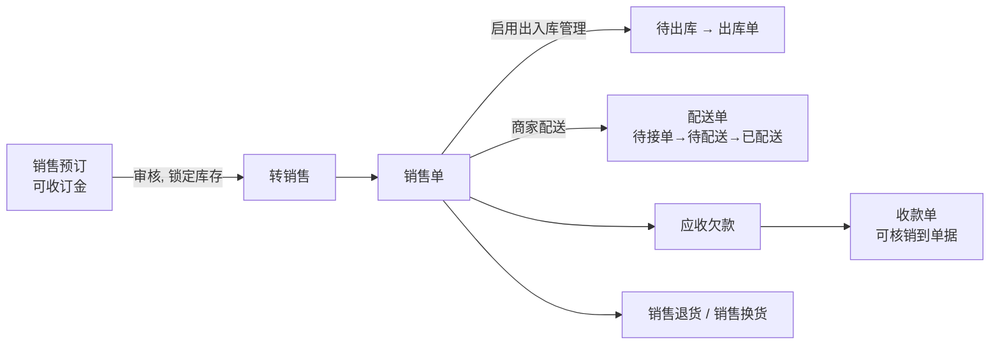
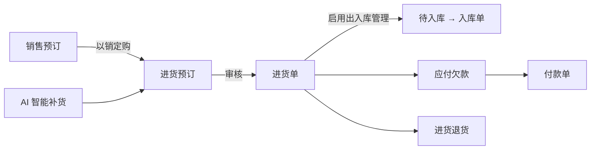
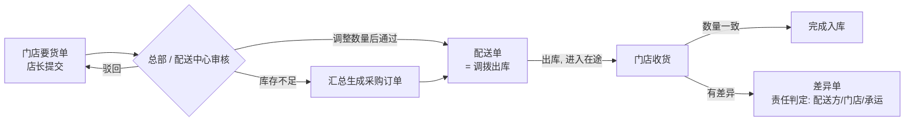

# 连锁门店进销存 —— 竞品分析与需求规格

| 项 | 内容 |
| --- | --- |
| 文档版本 | v0.1（初稿） |
| 编写日期 | 2026-11-15 |
| 调研对象 | 七色米进销存·连锁版（Web 端，`web.qisemiyun.com`，演示账号，行业模板选「烟酒食品」） |
| 调研方式 | 无头浏览器登录演示环境，遍历全部 10 个一级菜单约 150 个页面，抓取列表列、筛选条件、按钮、新增表单字段、业务设置全部参数、单号规则、角色权限树 |
| 未覆盖 | 移动端 App / 小程序端；零售收银（POS）界面（演示账号未配置收银结算账户，只看到收银设置页）；各单据详情页的全部操作；付费应用的内部页面 |

本文分两部分：**第一部分**完整拆解竞品的功能和连锁管控方式；**第二部分**在此基础上写出本系统（柠檬连锁ERP）的需求规格、优先级，以及与现有代码的对照。

---

# 第一部分 竞品分析

## 1. 产品定位

- **目标用户**：商贸中间商（批发为主、兼做零售），按行业提供 9 个模板：烟酒食品、家电数码、服装箱包、五金建材、母婴玩具、日化用品、文体图书、汽修汽配、其他。行业模板决定默认的商品属性和示例数据。
- **版本**：单店版、连锁版。连锁版的宣传语是「总部统一管控，分店独立经营；库存同步、价格统一、权限控制」。
- **终端**：Web、Windows / Mac 客户端、iOS / 安卓 App、微信小程序订货商城，另有打印助手和云打印机。
- **商业模式**：基础订阅，加上应用市场按项收费（配送管理、商城分销、积分商城、在线储值、优惠券、微信通知、AI 助手、物流助手、电商套件、OpenAPI、业绩提成、费用分摊、客户 RFM 等），短信按条计费。

## 2. 功能地图（连锁版完整菜单）

左侧一级导航 10 个，鼠标悬停弹出二级分组和页面：

| 一级 | 分组 → 页面 |
| --- | --- |
| **销售** | 销售：销售预订、销售、销售退货、销售换货、零售收银 ／ 拜访：客户拜访、车销/访销流程引导 |
| **营销** | 客户运营：客户积分、客户储值、营销短信、微信通知助手 ／ 营销玩法：特价活动、套餐活动、满赠活动、赠品、AI 营销助手 |
| **库存** | 进货：进货预订、以销定购、进货、进货退货、AI 智能补货 ／ 库存：盘点、调拨、组装拆卸、出库、入库、借出、借入、配送、成本调整、其他出库、其他入库 ／ 查询：库存查询、订单跟踪表、保质期批次清单、批次跟踪表、物流助手、成本异常检查 |
| **账务** | 往来账：应收欠款、收款、应付欠款、付款 ／ 更多账务：日常收支、收支项目、账户转账、销售开票、进货开票、费用成本分摊 ／ 查询：资金流水、业绩提成 |
| **分析** | 6 个仪表盘（销售、进货、库存、账务、商品、售后）+ 约 40 张报表，见 §7 |
| **资料** | 商品：商品、电商导入、商品图片、商品分类、商品模板、BOM 清单、属性设置、单位设置、商品自定义字段 ／ 往来单位：客户、AI 客户智能跟进、客户分类、客户等级价、客户最近售价查询、线路管理、供应商、供应商分类 |
| **设置** | 参数设置：业务设置、零售收银设置、单号规则设置、打印设置、移动支付 ／ 账户信息：企业资料维护、系统重置、结存、日期锁定 ／ 店铺管理：**门店**、仓库、车仓管理、结算账户、员工、角色权限、导购员、期初信息 |
| **电商** | 店铺设置：店铺授权、后台任务记录、商家物流、业务设置 ／ 商品管理：电商商品发布、商品对应关系 ／ 订单处理：电商订单、售后单 |
| **网店** | 订单：网店预订 ／ 网店商品：网店商品管理、网店商品分类、网店商品次分类、商品智能合并、商品标签 ／ 网店设置：网店设置、网店装修 ／ 网店运营：会员注册码、台卡、公告、广告管理、弹窗广告管理、网店访问记录、微信 QQ 推广、专属小程序商城 ／ 营销玩法：订单红包、优惠券、商城分销、积分商城、在线储值 ／ 分析：网店预订统计（按日期 / 状态 / 商品） |
| **发现** | 应用市场、应用管理、我的订单、周边商城 |

**首页**：今日销售毛利 / 销售额 / 销售笔数 / 资金入账；快捷入口（销售、进货、库存查询、商品、客户、应收欠款、日常收支、营销短信）；资产等式「总资产 = 账户余额 + 库存总额 + 应收欠款 − 应付欠款」；待办（销售预订待审、待出库、待入库、应收、应付）；可配置的报表卡片（带「AI 分析」）；网店访问、新功能提醒、新手任务。

## 3. 连锁管控模型（重点）

### 3.1 组织结构

```
企业（账套）
 └─ 门店：总部（内置，"在职能上管辖其他门店"）、分店1、分店2 ……
      ├─ 仓库（每个仓库属于一个门店，可设默认仓库）
      ├─ 结算账户（现金 / 银行，属于门店，可"锁定至指定日期"）
      ├─ 员工（属于一个门店，可有多个角色）
      ├─ 导购员（属于门店，零售收银时选择，无登录账号）
      └─ 车仓（车销用的移动仓库，属于门店）
```

- 门店资料很轻：名称、编号、联系人、电话、地址、邮箱、邮编、备注。**没有**门店类型（直营 / 加盟）、营业时间、区域、上级门店等字段。
- 只有两级：总部 + 分店，没有区域 / 片区层级。

### 3.2 哪些数据按门店归属、哪些总部统一

| 数据 | 归属方式 | 说明 |
| --- | --- | --- |
| 商品资料、分类、单位、属性 | **总部统一** | 全局一份，门店不能有自己的商品 |
| 商品价格（零售价、批发价、最低售价、参考进货价） | **总部统一** | 商品上只有一套价格；另有「客户等级价」（按客户等级定价）。**没有门店价 / 区域价** |
| 期初库存、库存预警（最低 / 最高库存） | 按仓库 | 新增商品时逐个仓库填期初数量和成本；预警可"所有仓库相同"或分仓设置 |
| 成本价 | 默认全局，可开「启用分仓成本价」 | 开启后按仓库分别计算成本，毛利按仓库成本算 |
| 客户 | 按门店 + 可共享 | 客户有"所属门店"，可"设为共享客户"让所有门店使用；应收欠款页可"不显示共享客户" |
| 供应商 | 按门店 + 可共享 | 同客户 |
| 业务单据 | 按门店 | 所有单据有"所属门店"列，由开单仓库 / 员工决定 |
| 结算账户、资金 | 按门店 | 账户转账可跨门店（转出门店 / 转入门店） |
| 营销活动、积分规则 | 总部统一 | 特价、套餐、满赠没有"适用门店"；满赠只有"适用渠道：全渠道 / 线上网店 / 线下门店" |
| 报表 | 可筛选 | 几乎所有报表都有「全部门店 / 总部 / 分店N」下拉 |

### 3.3 门店之间的库存流转：调拨

- 调拨单字段：出库仓库、入库仓库（可以是不同门店的仓库）、**调拨类型（平价调拨 / 异价调拨）**、单据编号、经手人、业务日期、明细（商品、属性、数量、单位、备注）、结算方式、其他费用、**分摊类型**（其他费用是否分摊到商品成本）、图片附件。
- 列表展示：调出门店、调出仓库、**出库状态**、调入门店、调入仓库、**入库状态** —— 开启「出入库管理」后，调拨分成调出出库、调入入库两步，中间是在途。
- **平价调拨**：按成本价平移，调入成本 = 调出成本；有参数「平价调拨展示商品价格」；列表导出有「平价调拨单价 / 金额」。
- **异价调拨**：门店之间按内部价调拨（调入成本 ≠ 调出成本，用于门店独立核算 / 加盟供货）；角色权限里"异价调拨"是单独的权限点。
- 报表：调拨统计-按商品（调入 / 调出数量和金额）、全能库存变动中的"调拨入库 / 调拨出库"。
- **没有**"门店要货申请 → 总部审核 → 配送"这样的补货流程，门店补货靠总部直接开调拨单，或门店自己进货。

### 3.4 权限模型

**功能权限（角色）**：三级 —— 一级（模块）、二级（页面）、权限配置细则（按钮）。内置角色：管理员、销售组、采购组、仓管组、财务组、查看组。细则举例：

- 单据类：查询、新增及编辑、作废、导出、打印、发送单据、审核、**修改单价**、**改整单折扣**、关闭；
- 库存：出库操作、入库操作、**异价调拨**、配送（关闭或作废、接单及处理）、借出（归还、转销售）、借入（归还、转进货）；
- 资料：商品导入、**期初库存维护**、客户期初欠款维护、积分清零、结算账户期初维护；
- 财务：开票、管理提成方案；
- 每张报表单独授权。

**数据权限（员工上配置）**：

| 权限项 | 取值 |
| --- | --- |
| 所属门店 | 单选 |
| 仓库权限 | 全部仓库 / 指定仓库 |
| 账户权限 | 全部账户 / 指定账户 |
| **价格权限** | 可见的价格：零售价、批发价、参考进货价、最低售价、**成本价**、等级价（多选） |
| 查看 / 编辑 / 作废他人单据 | 允许 / 不允许 |
| 查看他人客户、经手他人客户 | 允许 / 不允许 |
| 查看他人钱货日清、查看他人资金流水 | 允许 / 不允许 |
| 销售 / 收款时修改业务日期 | 允许 / 不允许 |
| 作废 / 关闭今日之前的单据 | 允许 / 不允许 |

结论：门店隔离主要靠「员工只授权本店的仓库和账户」+「不允许查看他人单据 / 客户」实现，而不是按门店硬隔离。

## 4. 核心业务流程

### 4.1 销售（批发）



- **销售预订**：处理状态（已审核未转销售 / 部分转销售 / 全部转销售 / 已关闭）、审核人、订金；操作：分享、复制、转销售、反审核、关闭；打印配货清单；可开"支持跟进记录"。
- **销售单**表单：客户、**销售类型（批发 / 零售，决定默认取价）**、仓库（可多仓）、经手人、业务日期；明细：数量、单位、单价、折扣率、折后单价、金额、备注、赠品；整单折扣、其他费用、优惠券、结算方式（可多账户）、实收金额、本单欠款、累计应收；送货方式（商家配送 / 客户自提 / 物流快递）、送货日期、收货地址（可粘贴自动识别）、客户定位、生成配送单、需要发票；图片、内部沟通。辅助：扫码录入、导入商品、选择模板、**AI 智能开单**、历史单据；保存为草稿。
- 列表区分「已出售 / 草稿」，展示毛利、抹零、扣除订金、发票状态、确认信息签名、确认收货签名。
- **销售换货**：一张单同时有退回和换出，关联销售单和销售退货单。
- **以出库统计欠款**（参数）：开单后不计欠款，实际出库后才计。

### 4.2 进货



- 进货单：关联订单号、供应商、入库仓库、折扣、应付、扣除订金、已付、发票状态 / 发票号 / 开票金额，可批量开票。
- 以销定购：审核后的销售预订生成进货预订 → 转进货 → 销售预订转销售。

### 4.3 零售收银（门店前台）

- 设置项：零头处理（抹零规则）、单行折扣、**允许欠款结算**、支付方式（现金 → 指定结算账户；银联卡 → 指定结算账户；移动支付 → 支付宝 / 微信，需开通有赞移动支付）。
- 有"导购员"资料（按门店），用于收银时记录导购业绩。
- 零售价来自商品的零售价；会员即客户（有积分、储值余额）。
- 从列表页结构看，零售收银的单据与销售换货共用列表（单据编号、客户、销售 / 退货 / 换出 / 换入数量、整单折扣、应收、实收）。
- **没有**看到交班 / 收银日结、挂单、钱箱、副屏、称重等 POS 专业功能（可能在客户端，未验证）。

### 4.4 库存作业

- **盘点**：选仓库 → 选商品 / 扫码 / 导入 → 账面数量、实际数量（"一键盘零"）、盈亏数量；"盘点前锁定"（锁定期间禁止出入库）；生成盘盈 / 盘亏金额。
- **出入库管理**（参数开启）：销售、销售退货、进货、进货退货、调拨、借入借出都先生成待出库 / 待入库，仓库再执行；可批量出入库、打印配货清单；可要求出入库必须上传图片、超出存货不允许出库、销售出库允许切换仓库。
- **借出 / 借入**：未归还数量、预计归还日期；借出可转销售、借入可转进货。
- **组装拆卸**：原商品（门店、仓库、总价）→ 新商品（门店、仓库、总价），可跨门店仓库。
- **成本调整**、**成本异常检查**（负库存出库导致的成本异常，可查看成本明细时间点）、**其他出库 / 其他入库**（带类型）。
- **配送**：待接单 → 待配送 → 已配送，可从销售单生成或手动新增；签收可要求客户签字、拍照、打卡（限定距离 50m–1km）。
- **库存查询**：按商品 / 按单品；当前存货、可用库存、期初、待出库、待入库、**锁库量**、成本价、库存总额；零库存、停用商品开关。
- **保质期批次清单**（剩余天数、预警天数、状态）、**批次跟踪表**、**订单跟踪表**（按预订单跟踪处理状态）。

### 4.5 账务

- 应收 / 应付：期初欠款 + 增加欠款 − 收回（支付）欠款 − 优惠 − 抵消欠款（客户与供应商互相关联时可抵消），支持账单周期、微信对账。
- 收款 / 付款：优惠金额、结算方式、确认信息签名；可开"核销"关联欠款单据、"账期管理"（到期提醒）。
- 日常收支（按收支项目，可分摊到商品成本：未分摊金额）、账户转账（跨门店、手续费及支付方）、费用成本分摊、销售开票 / 进货开票、资金流水（每日小计）、业绩提成（提成方案：按销售额比例等，适用商品 / 员工）。
- 可选「财务审核」：收款单、付款单、日常收支、账户转账、费用分摊审核后才计资金流水。
- **钱货日清**：按门店 / 账户 / 员工，资金汇总（销售收款、收款单、储值、订金、日常收支、退货款、优惠）、销售汇总、单据汇总、车仓库存汇总 —— 用于业务员 / 门店每日对账交款。
- **结存**（年 3 次，封存账期并结转期初）、**日期锁定**（锁定日期前的单据不可新增 / 编辑 / 作废）。

### 4.6 营销与会员

- 客户积分（默认每消费 1 元积 1 分，可按商品设置规则）、客户储值（储值金额 + 赠送金额）、营销短信（欠款催缴等）、微信通知助手。
- 特价活动（时间段 + 商品特价）、套餐活动（多个商品组合成套餐，有套餐销售价）、满赠活动（按数量 / 金额满赠，主商品全部或部分，最多 20 个赠品，适用渠道）、赠品（单据行勾选赠品价格为 0）、优惠券、订单红包、积分商城、在线储值、商城分销。
- 客户 RFM 分析（8 类客户分群，规则可编辑）。

### 4.7 线上渠道

- **网店（小程序订货商城）**：网店商品上下架、起订量、限购量、标签、独立的网店分类和次分类、装修、公告、广告、会员注册码（客户扫码注册后归属该员工门店）、台卡、访问记录；网店预订 → 合并订单 → 转销售 / 出库。
- **电商**：店铺授权（关联门店、仓库、结算账户、客户、经手人）、商品发布、商品对应关系与库存同步规则、电商订单（批量转销售）、售后单、商家物流 / 电子面单。

### 4.8 车销 / 访销（快消品）

客户定位 + 线路管理 → 车仓装车（调拨到车仓）→ 按线路拜访（签到、拍照、开单、签退）→ 钱货日清对账 → 余货调回仓库。

## 5. 业务设置（系统参数）清单

竞品把大量行为差异做成开关，这是它能覆盖多个行业的关键。完整清单：

| 分组 | 参数 |
| --- | --- |
| 基础资料 | 多属性组合商品（多规格 SKU）、启用商品序列号、商品分仓库管理、商品关联供应商、启用保质期批次、允许客户电话重复、新增客户时业务员默认为当前人 |
| 开单 | 销售 / 进货允许单行折扣；允许负库存开单（细分到：销售、进货退货、调拨、组装拆卸、借出借入归还、积分兑换、其他出库）；自动调整负库存；销售时检查最低售价（仅提示 / 禁止）；开单时展示最低售价；审核预订单时业务日期更新为当天；编辑草稿时业务日期更新为当天；销售 / 进货 / 销售退货 / 进货退货自动补齐实收（付、退）金额；销售支持多仓、智能选仓；套餐记忆最近售价；销售不带入最近售价、进货不带入最近进价；销售预订支持跟进记录；销售预订员工不可直接改价；首次开单默认销售类型（批发 / 零售）；**启用分仓成本价**；销售快速打印；销售 / 销售退货支持抹零；销售退货退回预订单；任何状态预订单都可编辑；销售支持配送员；**启用出入库管理**（分销售类 / 进货）；出入库必须上传图片；销售出库允许切换仓库；超出存货不允许出库；开单快捷新增客户 / 供应商；客户自提可录入联系信息；启用仓位管理；配送签收必须签字 / 拍照 / 打卡（距离）；销售默认需配送；**平价调拨展示商品价格**；销售单支持负数开单；单据编号重复时仅提示 |
| 账务 | 启用核销、启用账期管理、以出库统计欠款、启用销售税率 / 进货税率、启用财务审核（收款、付款、日常收支、转账、费用分摊）、订金计入欠款时机（关闭订单时 / 审核时） |
| 参数偏好 | 价格小数位、数量小数位、常用单位个数、列表导出仅导出勾选项 |
| 其他 | 首页展示 AI 助手、展示电商菜单 |

## 6. 单号规则

43 种编号，格式 `前缀{YYYY}{MM}{DD}{##}`，位数可设，Web / 安卓 / 苹果端规则分开（加后缀 A / I 防冲突）。前缀示例：客户 KH、供应商 GYS、进货 JHD、销售 XSD、付款 FKD、收款 SKD、盘点 PD、商品 SP、日常收支 SZ、进货退货 JTD、销售退货 XTD、组装拆卸 ZZCX、**调拨 DBD**、借入 JRD、借出 JCD、出库 CKD、入库 RKD、套餐 TC、进货预订 JDD、销售预订 XDD、特价 TJHD、网店预订 WD、费用分摊 FT、拜访 BF、换货 XHD、条形码 00、优惠券 YHQ、配送 PSD、积分兑换 DHD、储值 CZ、成本调整 CBTZ、满赠 DPMZ、BOM WL、其他入库 QTR 等。门店编号 MD。

## 7. 报表清单

所有报表支持时间快捷筛选（今日 / 昨日 / 本月 / 上月 / 自定义）、**门店筛选**、导出，部分带「AI 分析」。

| 类别 | 报表 |
| --- | --- |
| 销售 | 销售报表（按天）、销售统计-按商品 / 按客户 / 按仓库、销售明细-按单据 / 按商品、销售赠品统计、销售退货统计、销售预订统计（含参考库存缺口）、客户 RFM 分析 |
| 进货 | 进货报表、进货统计-按商品 / 按供应商、进货明细-按单据、进货赠品统计、进货预订统计 |
| 库存 | 进销对比分析、全能库存变动（按业务类型拆分的收发存：进货、销售退货、调拨、借入借出、盘点、组装、兑换）、库存周转分析（周转率、周转天数）、库存积压分析（积压系数、资金占用、"AI 帮我清库存"）、仓库库存分布、盘点统计、调拨统计 |
| 账务 | 经营状况（日报 / 月报 / 年报）、员工业绩统计、利润报表（收入类：销售毛利、日常收入、盘盈、费用等；支出类：日常支出、盘亏、优惠、抹零、红包、积分兑换成本、储值赠送等）、钱货日清、收支趋势、业务收支占比 |
| 商品 | 畅销商品、滞销商品、商品价格趋势（销售均价 / 进货均价）、商品热度（网店访问 / 点赞 / 留言） |
| 售后 | 配送报表（按日期 / 配送员 / 单据） |
| 网店 | 网店预订统计（按日期 / 状态 / 商品） |

另有「仪表盘视图」（我的 / 销售 / 进货 / 库存 / 账务 / 商品 / 售后，可把图表加入"我的"）和数据大屏。

## 8. 竞品评价

**优点**

1. 参数化程度高，一套系统通过开关适配批发、零售、车销、带出入库的仓库等多种场景。
2. 单据录入体验好：扫码、导入、模板、历史单据、最近售价记忆、AI 开单、快捷键（F8 实收、F9 保存并新增、Ctrl+S）。
3. 细粒度权限：价格可见性、他人单据 / 客户、改价、改折扣、修改业务日期都能单独控制。
4. 往来与资金闭环完整：订金、核销、账期、互抵、钱货日清、结存、日期锁定。
5. 线上线下一体：小程序订货商城、电商平台同步，营销工具丰富。

**不足（也是我们的机会点）**

1. **门店模型过轻**：只有总部 + 分店两级，没有门店类型（直营 / 加盟）、区域、营业状态；门店本身没有经营参数。
2. **没有门店级商品和价格策略**：价格全局统一，无法按门店 / 区域定价，没有调价单（定时生效、门店范围），门店不能单独上下架商品。
3. **没有门店要货 / 配送中心补货流程**：门店不能提交要货申请，总部无法汇总要货生成采购和配送；调拨没有在途差异处理、收货确认差异。
4. **加盟结算缺失**：异价调拨有了内部价，但没有加盟商往来账、配送价、对账结算。
5. **POS 偏轻**（Web 端可见部分）：未见交班日结、挂单 / 取单、会员卡、离线收银、称重、小票模板等门店前台必备功能。
6. **营销活动不能限定门店**：特价、满赠、套餐全局生效，只区分线上 / 线下。
7. **会员与客户混用**：零售会员和批发客户是同一个"客户"实体，会员等级、积分、储值的跨店通用规则和储值的门店间结算不清晰。
8. **门店考核弱**：缺少门店目标、门店损益（含分摊费用）、坪效 / 人效、门店对比排名。

---

# 第二部分 需求规格（柠檬连锁ERP · 连锁进销存）

## 9. 目标与范围

**目标**：为多门店连锁商家（零售为主、兼做批发 / 加盟供货）提供"总部管控 + 门店经营"的进销存系统，在竞品已有能力的基础上补齐门店模型、门店价格、要货配送、POS 收银、会员和门店考核。

**范围内**：组织与门店、商品与价格、采购、门店要货与配送、调拨、批发销售、零售收银、库存作业、会员营销、往来与资金、报表、权限与参数、小程序订货。

**范围外（本期）**：电商平台对接、车销访销、商城分销、短信 / 公众号营销、物流电子面单、财务总账（已有 fin 模块，只做业务凭证对接）。

**优先级定义**：**P0** 首个可用版本必须有；**P1** 第二阶段；**P2** 视需求排期。

## 10. 用户角色

| 角色 | 典型岗位 | 关注点 |
| --- | --- | --- |
| 老板 / 总经理 | 总部 | 全部门店经营数据、利润、库存资金占用 |
| 总部运营 / 商品 | 总部 | 商品资料、价格策略、营销活动、门店配置 |
| 采购 | 总部 | 供应商、采购订单、补货建议、到货 |
| 配送中心 / 仓管 | 总部仓 | 入库、门店要货审核、配送出库、盘点 |
| 财务 | 总部 | 应收应付、资金、门店日结对账、加盟结算、日期锁定 |
| 店长 | 门店 | 本店销售、库存、要货、盘点、员工、日结 |
| 收银员 / 店员 | 门店 | POS 收银、退换货、会员 |
| 导购员 | 门店 | 业绩（不一定有账号） |
| 批发业务员 | 总部或门店 | 批发客户开单、收款 |
| 加盟商（P1） | 加盟店 | 向总部订货、对账 |

## 11. 组织与门店模型

### 11.1 层级

```
租户（企业）
 └─ 区域（可多级，P1）
      └─ 门店：类型 = 总部 / 直营店 / 加盟店 / 配送中心
           ├─ 仓库（门店仓、配送中心仓、车仓；每个仓库属于一个门店）
           ├─ 结算账户（现金、银行、微信、支付宝、储值，按门店）
           ├─ POS 收银台（P0，设备 / 收银台编号）
           └─ 员工（主属门店 + 可管辖门店）
```

### 11.2 门店资料（P0）

| 字段 | 说明 |
| --- | --- |
| 编号、名称、简称 | 编号走单号规则 |
| 门店类型 | 总部 / 直营 / 加盟 / 配送中心；总部唯一 |
| 所属区域 | P1 |
| 上级配送门店 | 该店要货默认由哪个配送中心 / 总部供货 |
| 价格方案 | 该店使用的零售价方案（见 §12.2） |
| 状态 | 筹备 / 营业 / 停业 / 闭店；停业、闭店不能开单 |
| 联系人、电话、地址、经纬度、营业时间、面积 | 面积用于坪效 |
| 默认仓库、默认结算账户 | 开单默认值 |
| 加盟信息（加盟店） | 加盟商名称、合同期、保证金、结算方式、配送价方案（P1） |

**规则**：
- 门店有业务数据后不能删除，只能停业 / 闭店。
- 每个门店至少一个仓库；新建门店时可自动创建同名仓库和现金账户。
- 门店数量受租户套餐限制（复用 SaaS 套餐配置）。

### 11.3 数据归属规则（P0）

| 数据 | 归属 |
| --- | --- |
| 商品、分类、单位、属性、品牌 | 总部统一；门店可设置"本店经营商品"（上下架）P1 |
| 价格 | 总部统一定价 + 门店价格方案覆盖（§12.2） |
| 供应商 | 总部统一，可限定"可供应门店"（P1，门店直采） |
| 客户 / 会员 | 会员全局通用（开卡门店记录在会员上）；批发客户按门店 + 可共享 |
| 单据 | 都带 `门店`（由仓库或收银台决定），不能修改 |
| 营销活动 | 总部创建，必须指定**适用门店**（全部 / 指定门店 / 指定区域）和渠道 |
| 报表 | 默认按员工可见门店过滤，可选门店 / 区域 |

## 12. 功能需求

### 12.1 基础资料

| 编号 | 功能 | 说明 | 优先级 |
| --- | --- | --- | --- |
| BD-01 | 商品资料 | 编号、条码（多条码）、名称、分类（多级）、品牌、单位、多单位换算、多规格 SKU、图片、保质期、批次 / 序列号管理、重量体积、自定义字段、停用；期初库存按仓库录入 | P0 |
| BD-02 | 称重 / 计件商品 | 生鲜称重条码解析（PLU） | P2 |
| BD-03 | 套餐 / 组合商品 | 销售时按成分扣减库存；组装拆卸 | P1 |
| BD-04 | 商品导入导出 | Excel 导入、AI 拍照 / 识别新增（复用 ai 模块智能录入） | P0 / P2 |
| BD-05 | 库存预警 | 按仓库设置最低 / 最高库存、保质期预警天数 | P0 |
| BD-06 | 供应商 | 分类、联系信息、期初应付、关联商品及供货价 | P0 |
| BD-07 | 客户（批发） | 所属门店、共享、业务员、价格等级、信用额度、账期、期初应收 | P0 |
| BD-08 | 会员 | 见 §12.8 | P0 |
| BD-09 | 门店 / 仓库 / 结算账户 / 收银台 | 见 §11 | P0 |
| BD-10 | 员工 | 所属门店、可管辖门店、角色、数据权限（§13） | P0 |
| BD-11 | 导购员 | 按门店，可无登录账号 | P1 |

### 12.2 价格管理

| 编号 | 功能 | 说明 | 优先级 |
| --- | --- | --- | --- |
| PR-01 | 价格列 | 零售价、会员价、批发价（多级）、最低售价、参考进价、配送价 | P0 |
| PR-02 | 门店价格方案 | 一个方案 = 一组商品价格覆盖；门店绑定方案；取价顺序：活动价 → 门店方案价 → 总部价 | P0 |
| PR-03 | 调价单 | 选择商品和门店（或方案），填新价，**生效时间**（立即 / 定时），审核后生效，保留调价历史 | P0 |
| PR-04 | 客户价格等级、客户最近售价 | 批发场景 | P0 |
| PR-05 | 最低售价控制 | 参数：仅提示 / 禁止；改价权限 | P0 |
| PR-06 | 价格可见权限 | 成本价、进价、批发价按员工控制是否可见 | P0 |
| PR-07 | 门店自主调价 | 总部授权门店在限定幅度内调价 | P2 |

### 12.3 采购

| 编号 | 功能 | 说明 | 优先级 |
| --- | --- | --- | --- |
| PU-01 | 采购订单 | 供应商、收货门店 / 仓库、订金、审核；状态：待审核 / 已审核 / 部分入库 / 全部入库 / 已关闭 | P0 |
| PU-02 | 采购入库 | 由订单转入或直接开单；结算方式、实付、其他费用（可分摊到成本）、发票 | P0 |
| PU-03 | 采购退货 | 关联入库单或直接退 | P0 |
| PU-04 | 要货汇总生成采购 | 汇总门店要货单的缺口，按供应商拆分生成采购订单 | P0 |
| PU-05 | 补货建议 | 按销量、安全库存、在途计算建议量（P1 规则版，P2 用 AI） | P1 / P2 |
| PU-06 | 门店直采 | 授权门店向指定供应商直接进货 | P1 |
| PU-07 | 以销定购 | 批发预订单转采购 | P1 |

### 12.4 门店要货与配送（连锁核心，竞品缺失）



| 编号 | 功能 | 说明 | 优先级 |
| --- | --- | --- | --- |
| DS-01 | 门店要货单 | 选择商品和数量，显示本店库存、在途、近 7 / 30 天销量、建议量；要货时间段控制（P1） | P0 |
| DS-02 | 要货审核 | 配送中心按门店 / 商品汇总审核，可改批准数量；审核后生成配送单 | P0 |
| DS-03 | 配送单（配送出库） | 本质是跨门店调拨；按配送价或成本价结算（§12.5）；打印拣货单 / 配送单 | P0 |
| DS-04 | 在途库存 | 出库后计入在途，不计入任一门店可用库存 | P0 |
| DS-05 | 门店收货 | 按单收货（扫码核对），实收与发出不一致生成差异单 | P0 |
| DS-06 | 差异处理 | 差异单审核后按责任方调整：退回配送方 / 门店报损 / 承运赔偿 | P1 |
| DS-07 | 门店退货给总部 | 门店退仓单 → 总部收货 | P0 |
| DS-08 | 自动要货 | 按门店库存上下限每日自动生成要货单 | P2 |
| DS-09 | 配送线路 / 车辆 | 按线路批量出库、司机签收 | P2 |

### 12.5 调拨

| 编号 | 功能 | 说明 | 优先级 |
| --- | --- | --- | --- |
| TR-01 | 调拨单 | 调出仓库 → 调入仓库（同店或跨店）；两步：调出确认（在途）→ 调入确认 | P0 |
| TR-02 | 平价调拨 | 调入成本 = 调出成本，不产生门店间往来 | P0 |
| TR-03 | 异价调拨（内部结算价） | 调拨价按：成本价 × 系数 / 价格列 / 手工填写；调入成本 = 调拨价；差额记为调出门店的内部收入，用于门店独立核算 | P0 |
| TR-04 | 门店间往来 | 异价调拨、加盟配送生成门店间（或与加盟商间）应收应付，可对账结算 | P1 |
| TR-05 | 调拨费用 | 运费等其他费用，可分摊到调入成本 | P1 |
| TR-06 | 跨店调拨审批 | 可接入审批流程（复用 workflow） | P1 |

### 12.6 批发销售

| 编号 | 功能 | 说明 | 优先级 |
| --- | --- | --- | --- |
| SA-01 | 销售订单（预订） | 订金、审核后锁定库存、转销售、部分转、关闭；配货单打印 | P0 |
| SA-02 | 销售单 | 客户、销售类型（批发 / 零售取价）、仓库（多仓）、行折扣、整单折扣、抹零、赠品、其他费用、多结算方式、本单欠款；草稿；送货方式与地址 | P0 |
| SA-03 | 销售退货 | 关联原单（按原价退）或无原单 | P0 |
| SA-04 | 销售换货 | 一张单同时退回和换出 | P1 |
| SA-05 | 出库管理 | 参数开启后销售先生成待出库，仓库执行出库（复用 wms 出库） | P1 |
| SA-06 | 配送 / 签收 | 配送单状态、签名、拍照 | P2 |
| SA-07 | 单据分享 / 在线确认 | 客户扫码查看、电子签名确认 | P2 |

### 12.7 零售收银（POS）

| 编号 | 功能 | 说明 | 优先级 |
| --- | --- | --- | --- |
| POS-01 | 收银台登录 | 员工 + 收银台；只能在本店收银台收银 | P0 |
| POS-02 | 开单 | 扫码 / 搜索 / 快捷商品；数量、单行改价（权限）、单行 / 整单折扣（权限、上限）；自动应用门店价和活动价 | P0 |
| POS-03 | 会员 | 手机号 / 会员码识别；会员价、积分抵扣、储值支付、优惠券核销 | P0 |
| POS-04 | 多方式支付 | 现金（找零）、微信、支付宝（扫码付 / 付款码）、银行卡、储值、组合支付；每种方式对应门店结算账户 | P0 |
| POS-05 | 抹零规则 | 抹分 / 抹角 / 四舍五入 | P0 |
| POS-06 | 挂单 / 取单 | | P0 |
| POS-07 | 退货 / 换货 | 按小票号原单退，或无单退（权限） | P0 |
| POS-08 | 小票打印 | 58 / 80mm 模板，复用打印模块；钱箱 | P0 |
| POS-09 | 交班 / 日结 | 收银员交班：应收、实收（按支付方式）、现金差额；门店日结后当日单据锁定 | P0 |
| POS-10 | 导购员业绩 | 单据记录导购员 | P1 |
| POS-11 | 离线收银 | 断网时本地开单，恢复后同步 | P2 |
| POS-12 | 客显 / 副屏、称重 | | P2 |

> 实现形态建议：P0 先做 Web 收银页（全屏、键盘快捷键、扫码枪输入），P2 再考虑桌面端离线。

### 12.8 会员与营销

| 编号 | 功能 | 说明 | 优先级 |
| --- | --- | --- | --- |
| MK-01 | 会员档案 | 手机号唯一、开卡门店、等级、积分、储值余额、生日、标签；全部门店通用 | P0 |
| MK-02 | 会员等级 | 等级规则（累计消费 / 手动）、等级折扣或会员价 | P1 |
| MK-03 | 积分 | 消费积分规则（按金额 / 商品 / 分类，可排除商品）、积分抵现、积分兑换、清零 | P1 |
| MK-04 | 储值 | 充值（充 X 送 Y）、消费、退款；储值余额全门店通用；**跨店消费的门店间结算**（充值门店 vs 消费门店） | P1 |
| MK-05 | 特价活动 | 时间段、商品、特价、**适用门店**、渠道、会员限定、限购 | P0 |
| MK-06 | 满减 / 满折 / 满赠 | 按金额 / 数量，商品范围，适用门店 | P1 |
| MK-07 | 组合套餐 | 套餐价 | P1 |
| MK-08 | 优惠券 | 满减券、折扣券；发放、领取、核销、有效期、适用门店 | P2 |
| MK-09 | 活动叠加规则 | 活动之间是否可叠加、优先级 | P1 |
| MK-10 | 会员分析 | 新增、活跃、复购、RFM（复用 crm 的 RFM） | P1 |

### 12.9 库存作业

| 编号 | 功能 | 说明 | 优先级 |
| --- | --- | --- | --- |
| ST-01 | 库存查询 | 按门店 / 仓库 / 商品 / 分类；现存、可用、锁定、在途、待出 / 待入、成本、金额；单品（SKU）视图 | P0 |
| ST-02 | 库存流水 | 每笔变动，可追溯单据 | P0 |
| ST-03 | 盘点 | 全盘 / 抽盘；盘点前锁定（冻结出入库）；扫码录入、导入；盘盈盘亏审核后生效；多人分区盘点（P1） | P0 |
| ST-04 | 报损 / 报溢 | 其他出入库带类型（报损、试吃、自用、赠送） | P0 |
| ST-05 | 组装拆卸 | | P1 |
| ST-06 | 成本调整、成本异常检查 | 负库存导致的成本异常 | P1 |
| ST-07 | 保质期批次 | 批次、到期预警、近效期优先出库（FEFO） | P1 |
| ST-08 | 借入 / 借出 | | P2 |
| ST-09 | 负库存控制 | 参数按业务类型允许 / 禁止 | P0 |

### 12.10 往来与资金

| 编号 | 功能 | 说明 | 优先级 |
| --- | --- | --- | --- |
| FI-01 | 应收 / 应付 | 期初 + 增加 − 收付 − 优惠 − 抵消；按门店、业务员筛选；对账单 | P0 |
| FI-02 | 收款 / 付款 | 优惠、多账户、核销到单据（参数） | P0 |
| FI-03 | 日常收支 | 收支项目（门店费用：房租、水电、工资），按门店；可分摊到商品成本（P2） | P0 |
| FI-04 | 账户转账 | 跨门店账户转账（门店现金上缴总部） | P0 |
| FI-05 | 资金流水 | 按账户、门店、日期，每日小计 | P0 |
| FI-06 | 门店日结 / 钱货日清 | 按门店 / 员工汇总当日销售、收款（按支付方式）、费用、应缴现金；店长确认、财务复核 | P0 |
| FI-07 | 加盟商结算 | 配送货款、加盟费、保证金、对账、收款 | P1 |
| FI-08 | 储值跨店结算 | | P1 |
| FI-09 | 开票登记 | 销售 / 进货发票 | P1 |
| FI-10 | 业绩提成 | 按员工 / 导购，方案按销售额 / 毛利 / 商品 | P1 |
| FI-11 | 日期锁定 / 结账 | 锁定日期前的单据禁止新增、修改、作废 | P0 |
| FI-12 | 业务凭证 | 进销存单据生成凭证到总账（复用 fin） | P2 |

### 12.11 报表

| 编号 | 报表 | 维度 | 优先级 |
| --- | --- | --- | --- |
| RP-01 | 首页经营看板 | 今日 / 本月销售额、毛利、客单数、客单价；门店排行；待办（待审要货、待收货、待审单据、库存预警、临期） | P0 |
| RP-02 | 销售统计 | 按日期 / 门店 / 商品 / 分类 / 客户 / 员工 / 导购 / 支付方式 | P0 |
| RP-03 | 销售明细 | 按单据 / 按商品 | P0 |
| RP-04 | 采购统计 | 按商品 / 供应商 / 门店 | P0 |
| RP-05 | 收发存汇总 | 期初、各业务类型入库 / 出库、期末（数量、金额），按门店 / 仓库 | P0 |
| RP-06 | 门店对比 | 销售、毛利、毛利率、客单价、坪效、人效、同比环比 | P0 |
| RP-07 | 要货 / 配送统计 | 要货满足率、配送及时率、收货差异率 | P1 |
| RP-08 | 调拨统计 | 按门店 / 商品，调入调出 | P1 |
| RP-09 | 库存周转、积压、滞销、畅销 | 按门店 | P1 |
| RP-10 | 门店损益 | 销售毛利 − 门店费用 ± 内部调拨差价 − 分摊总部费用 | P1 |
| RP-11 | 会员消费分析、储值余额、积分 | | P1 |
| RP-12 | 收银日报 | 按收银员 / 支付方式 / 班次 | P0 |
| RP-13 | 价格趋势、毛利异常（低于最低售价的销售） | | P2 |

### 12.12 系统设置

| 编号 | 功能 | 说明 | 优先级 |
| --- | --- | --- | --- |
| SY-01 | 业务参数 | 参照 §5 选取：多规格、批次保质期、序列号、负库存（按业务）、最低售价控制、启用出入库管理、分仓成本、抹零、自动补齐实收、订金计入欠款时机、价格 / 数量小数位等 | P0 |
| SY-02 | 单号规则 | 每种单据前缀 + 日期 + 流水，可含门店编码（复用 `DocNoService`） | P0 |
| SY-03 | 打印模板 | 小票、A4 / 针式套打（复用 JasperReports 打印） | P0 |
| SY-04 | 角色与权限 | 见 §13 | P0 |
| SY-05 | 期初 | 期初库存、期初应收应付、期初账户余额 | P0 |
| SY-06 | 操作日志 | 复用 | P0 |

### 12.13 小程序

| 编号 | 功能 | 说明 | 优先级 |
| --- | --- | --- | --- |
| MP-01 | 店长端 | 门店看板、要货、收货、盘点、库存查询、审批 | P1 |
| MP-02 | 会员端 | 会员码、积分、储值余额、优惠券、消费记录 | P2 |
| MP-03 | 批发客户订货商城 | 商品浏览、下单生成销售订单、订单跟踪 | P2 |

## 13. 权限与数据隔离

**功能权限**：沿用本系统的菜单 + 按钮权限（`@ss.hasPerm`、`v-perm`），补充以下敏感操作权限点：修改单价、修改折扣（含折扣上限）、低于最低售价销售、异价调拨、审核要货、无原单退货、作废他人单据、修改业务日期、作废今日前单据、查看成本价、查看进价、期初维护、积分清零、储值调整。

**数据权限**（在本系统现有部门数据权限基础上扩展）：

| 维度 | 规则 |
| --- | --- |
| 门店 | 员工有"可管辖门店"（默认 = 所属门店；总部人员可为全部）。单据、库存、资金、会员消费记录按门店过滤 |
| 仓库 | 可操作仓库 ⊆ 可管辖门店的仓库 |
| 结算账户 | 可用账户 ⊆ 可管辖门店的账户 |
| 他人数据 | 查看 / 编辑 / 作废他人单据、查看他人客户可单独控制 |
| 价格字段 | 不可见的价格在接口层脱敏（不能只靠前端隐藏） |

**内置角色**：老板、总部运营、采购、配送中心、财务、店长、收银员、只读。

## 14. 关键业务规则

1. **库存扣减**：所有库存变动经统一库存服务，单据确认（审核）时生效，草稿不影响库存；并发下不允许超卖（负库存参数关闭时）。
2. **可用库存** = 现存 − 锁定（已审核订单、盘点冻结）；在途单列，不计入调出方和调入方的可用库存。
3. **成本**：默认移动加权平均；参数"分仓成本"开启时按仓库（即按门店）分别计算；异价调拨的调入成本 = 调拨价；平价调拨调入成本 = 调出时成本。
4. **门店损益口径**：销售毛利按门店仓库成本计算；异价调拨差价计入调出门店"内部调拨收入"、调入门店成本；总部费用分摊规则可配置（按销售额 / 面积 / 平均）。
5. **取价顺序**（零售）：生效中的活动价（适用本店）→ 会员价 / 会员折扣 → 门店价格方案 → 总部零售价；批发：客户等级价 → 客户最近售价（参数）→ 批发价。
6. **单据状态**：草稿 → 待审核（可选审批）→ 已审核 / 已完成 → 已作废（红冲，生成反向流水，不物理删除）。已被引用的单据不能作废，需先作废下游单据。
7. **日期锁定 / 日结**：锁定日期前、已日结门店的当日单据不能新增、修改、作废。
8. **会员与储值**：储值余额全局一份；每笔充值 / 消费记录门店，用于跨店结算报表。
9. **单据门店**：由仓库（进销存单据）或收银台（POS）决定，保存后不可改。

## 15. 非功能需求

| 类别 | 要求 |
| --- | --- |
| 性能 | POS 扫码到出行 < 300ms；结算提交 < 1s；常用报表（单门店月度）< 3s；支持 100 家门店、10 万 SKU、单店日 2000 单 |
| 可用性 | POS 断网可用（P2）；其余页面适配 1366 宽屏；收银页支持全键盘操作 |
| 一致性 | 单据确认、库存、资金在同一事务；调拨两步之间的在途必须可对账 |
| 安全 | 接口层的价格脱敏、门店数据隔离；操作日志；敏感操作二次确认 |
| 多租户 | 沿用 SaaS 共享库 `tenant_id` 隔离；新租户初始化总部门店、默认仓库、现金账户、内置角色 |
| 国际化 | 沿用中 / 英文资源包约定 |
| 硬件 | 扫码枪（键盘模式）、小票打印机、钱箱；P2 称重秤、客显 |

## 16. 与现有柠檬连锁ERP的对照（初步）

> 依据 `docs/development.md` 和 `sql/init.sql` 的表结构做的初步判断，未逐一阅读代码，具体实现前需要再确认。

| 需求 | 现有基础 | 判断 |
| --- | --- | --- |
| 商品、多单位、多规格、批次、序列号、分类、价格列（零售价 + 批发价 1-8）、客户价格等级、价格记忆 | `wms_material*`、`wms_price_level`、`scm_customer_price`、`scm_price_memory` | **复用** |
| 仓库、库位、库存、流水、盘点、组装拆卸、成本 | `wms_warehouse`、`wms_stock`、`wms_stock_flow`、`wms_check`、`wms_assembly`、`wms_material_cost` | **复用** |
| 调拨（同价 / 差价，调拨价依据：参考成本、库存均价、最低售价、价格列 × 系数） | `wms_stock_doc` 的 `transfer_pricing` / `transfer_price` 等字段 | **复用**，确认是否已有在途两步；补门店间往来 |
| 采购 / 销售订单、进销存单据、促销、返利、发货 | `scm_order`、`scm_trade_doc`、`scm_promotion`、`scm_delivery` | **复用**；促销需加"适用门店" |
| 应收应付、收付款核销、收支类别与收支单、账户调拨、提成 | `fin_bill`、`fin_settlement`、`fin_io_*`、`fin_fund_transfer`、`fin_commission_*` | **复用** |
| 审批、单号规则、打印、数据权限、多租户、AI | workflow、`DocNoService`、`PrintService`、datascope、tenant、ai 模块 | **复用** |
| **门店实体**（类型、状态、价格方案、上级配送门店） | 无（仅部门 `sys_dept`） | **新增**：建议新建门店表并关联部门，仓库、结算账户、员工增加门店归属 |
| **门店维度数据权限** | 现有按部门 / 本人的数据权限 | **改造**：增加"可管辖门店"维度 |
| **门店价格方案、调价单** | 无 | **新增** |
| **门店要货 → 审核 → 配送 → 收货差异** | 无 | **新增**（配送出库底层复用调拨） |
| **零售收银 POS、交班日结** | 无（schema 中无收银相关表） | **新增** |
| **会员、积分、储值** | 无（schema 中无积分 / 储值） | **新增**（或在客户上扩展，见待确认问题） |
| **门店日结 / 钱货日清、日期锁定** | 有会计期间结账；无业务日期锁定 | **新增** |
| 门店对比、门店损益报表 | bi 模块有进销存报表与商品分析 | **改造**：增加门店维度 |

## 17. 迭代建议

| 阶段 | 内容 | 目标 |
| --- | --- | --- |
| **M1 门店底座** | 门店模型、仓库 / 账户 / 员工门店归属、门店数据权限、门店价格方案 + 调价单、报表门店筛选 | 现有进销存在多门店下跑通 |
| **M2 门店前台** | POS 收银（开单、会员识别、多支付、挂单、退货、小票、交班日结）、会员档案、特价活动（适用门店）、门店日结、收银日报 | 门店能营业 |
| **M3 总部供应链** | 要货单、要货审核与汇总采购、配送出库 / 在途 / 门店收货、门店退仓、调拨两步、日期锁定、门店对比报表 | 总部能给门店补货 |
| **M4 深化** | 积分、储值及跨店结算、满减满赠、加盟结算、门店损益、补货建议、店长小程序、差异处理 | 精细化运营 |

## 18. 待确认问题

1. **业态**：目标客户以零售门店为主（POS 是核心），还是以批发为主（参照竞品）？这决定 M2 和 M3 的先后。
2. **加盟**：首期是否需要支持加盟店（独立结算、配送价、加盟商订货）？
3. **会员与批发客户**：会员是否单独建模，还是与现有客户（`scm_customer`）合并为一个实体加类型区分？
4. **POS 形态**：Web 收银页是否满足，还是需要 Windows 客户端 / 安卓收银机 / 离线收银？
5. **支付**：需要对接哪家聚合支付（微信 / 支付宝官方、收钱吧、拉卡拉等）？
6. **门店层级**：是否需要区域 / 片区（多级）？
7. **成本口径**：默认全局加权，还是默认按门店（分仓）成本？门店是否独立核算利润？

---

## 附：调研原始资料

演示环境截图和逐页抓取的文本保存在本次会话的临时目录（会话结束后可能被清理），如需留档请另行复制：

- 根目录：`/private/tmp/claude-501/-Users-zhoujinhua-Documents-idea-project-lemon-retail/28d58f84-7ae5-411f-9051-a48e662284f5/scratchpad/out/`
- 菜单树：根目录下 `menus.json`
- 逐页文本 / 截图：根目录下 `pages/`（约 150 页）
- 表单、业务设置、角色权限、单号规则：根目录下 `deep/`
